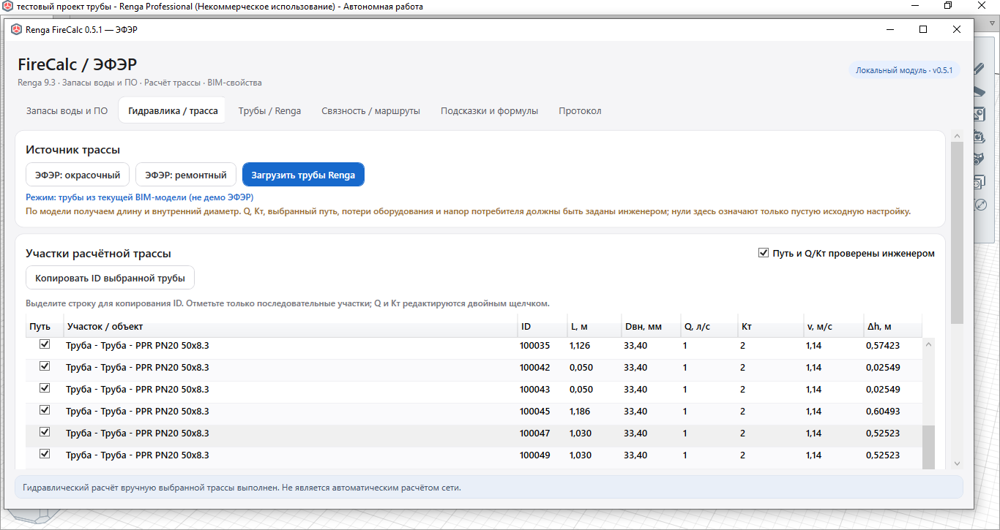

# Renga FireCalc


**Renga FireCalc** is a local WPF/C# engineering prototype for Renga Professional 9.3. It reads BIM pipes and engineering routes, computes pipe volumes and user-defined hydraulic paths, estimates water/foam reserves and exports reports to Excel/CSV.

**Developer:** `kartashov_ma` · **Release:** `0.5.1.0` · **API:** 2.50 · **OS:** Windows x64.

> [!WARNING]
> **Not a certified fire protection design tool.** Complex networks, pump Q–H curves, valves, fittings and pressure drops require independently verified data and a qualified engineer. A set of selected BIM pipes is not necessarily a physically continuous hydraulic network.

| Feature | Status |
|:---|:---|
| Water and foam reserve estimation | Implemented; user-tested demo |
| BIM pipe geometry & volumes | Implemented; user-tested |
| BIM property writeback for pipe volume | Implemented; user-tested |
| Manual hydraulic path calculation | Implemented; engineering assumptions required |
| Route and port connectivity diagnostics | Implemented; known gaps across equipment |
| Tree flow propagation | Prototype; not validated on the user's complete pump network |
| Pump duty/standby scenario | Metadata/description only; no pump performance calculations |
| XLSX and CSV export | Implemented |
| Tooltips, formula glossary & ID actions | Implemented; some interactions still need verification |



## Build

Install Visual Studio 2022/2026 with the .NET 8 Desktop SDK and obtain the official Renga 9.3 SDK. **Vendor SDK binaries are not included** in this repository.

```powershell
.\PREPARE_SDK.ps1 -SdkZip "C:\Path\To\RengaSDK93.zip"
.\BUILD_AND_DEPLOY.ps1
```

Alternatively open `FireCalc.sln`, choose **Release / x64**, and rebuild. The output is `_build\FireCalc`. Close Renga, back up the previous plugin, and copy **all** output files to `C:\Program Files\Renga Professional\Plugins\FireCalc`.

For detailed Russian documentation, see [README.md](README.md), [INSTALL_RU.md](docs/INSTALL_RU.md) and [USER_GUIDE_RU.md](docs/USER_GUIDE_RU.md).

## Important restrictions

Some historical demo fixtures were prepared from customer-provided reference material. Verify publication rights before making the repository public. Customer originals, third-party plugins and SDK binaries have been excluded. No ready-to-run compiled Windows DLL is distributed with this source package.

**© 2026 `kartashov_ma`. All rights reserved.** See [LICENSE](LICENSE) and [THIRD_PARTY_NOTICES.md](THIRD_PARTY_NOTICES.md).
