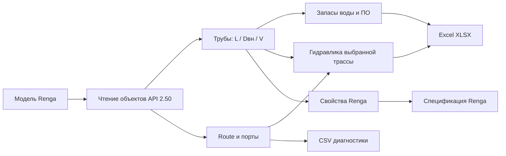
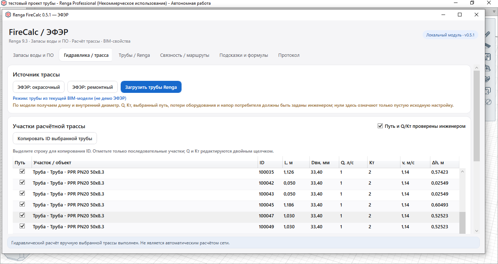
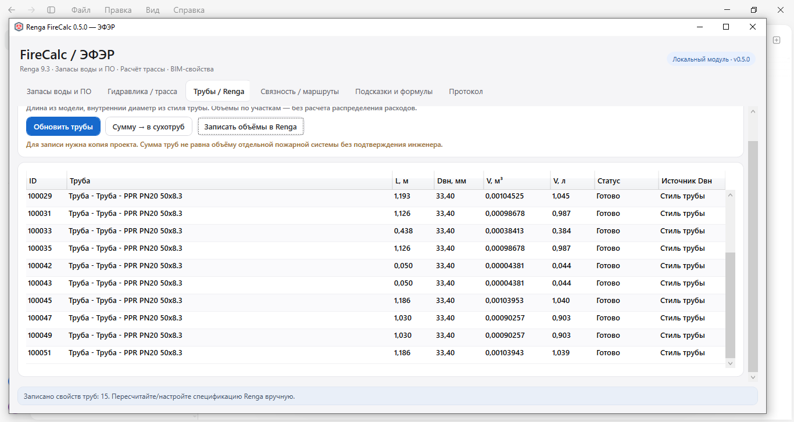
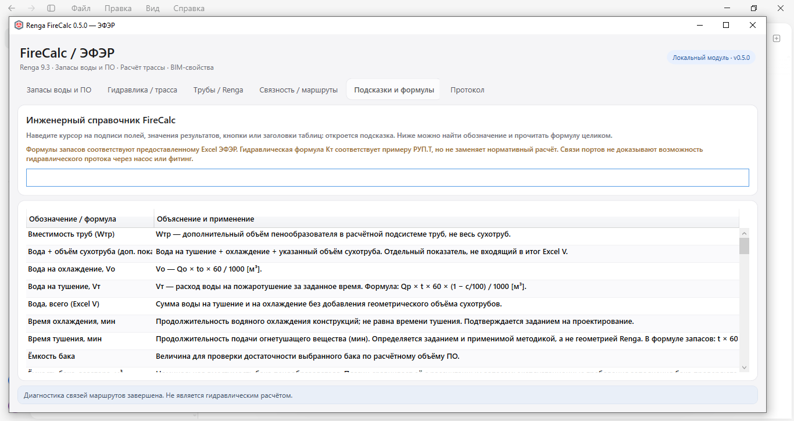
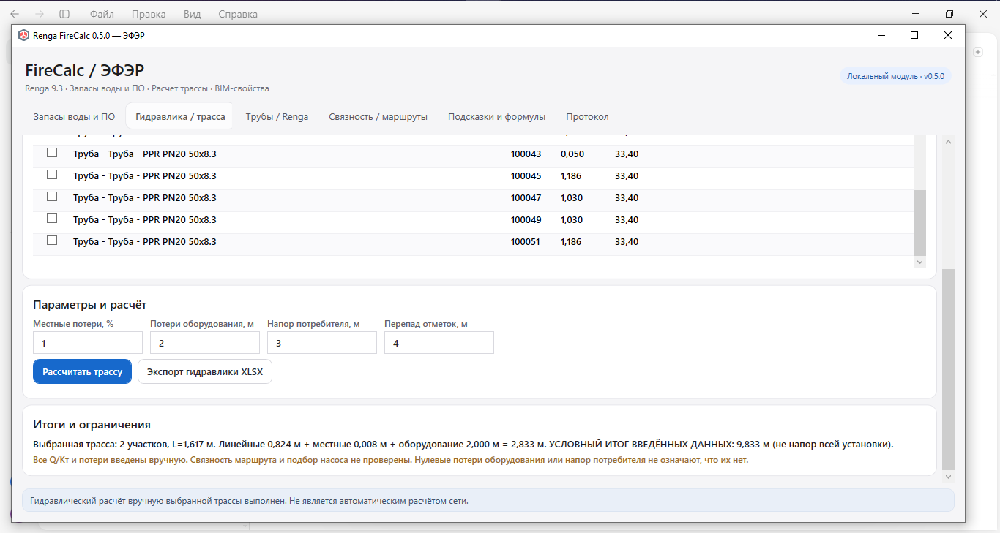

# Renga FireCalc


**Renga FireCalc** — локальный модуль расчётов и BIM-диагностики инженерных трубопроводных систем в **Renga Professional**. Разработан как экспериментальный инструмент для проектирования установок водяного и пенного пожаротушения, в том числе с насосами, арматурой и разветвлёнными трассами.

**Автор / разработчик:** `kartashov_ma` · **Версия:** `0.5.1.0` · **Язык:** русский (UI), русская и английская документация.

> [!IMPORTANT]
> **Инженерный прототип, а не сертифицированная система расчёта пожаротушения.** Часть исходных параметров и трасса задаются инженером. Расчёт гидравлики по произвольно выделенным трубам не означает, что проверены связность, режим насосов, нормативные коэффициенты и фактическое распределение расходов.

> [!CAUTION]
> Репозиторий подготовлен для **частной публикации**: в исходниках присутствуют учебно-демонстрационные сценарии, исторически созданные по материалам заказчика ЭФЭР. Перед переводом репозитория в публичный статус отдельно проверьте право на публикацию примеров, числовых данных и клиентских названий. Исходные PDF, Excel и модели заказчика не входят в комплект.

## Возможности

| Функция | Реализация | Проверка |
|:--|:--|:--|
| Расчёт запасов воды и пенообразователя | По локальным формулам, с проверкой вместимости бака | Запуск в Renga 9.3 подтверждён |
| Получение труб из BIM | Длины, внутренние диаметры из стилей труб, геометрический объём | Подтверждено на тестовых моделях |
| Обратная запись свойств | Запись объёма трубы в пользовательское свойство Renga; использование в спецификации | Подтверждено |
| Гидравлика выбранной трассы | Расход Q и Кт на участке, линейные/местные потери, скорость, итоговый условный напор | Вычислительный механизм подтверждён, инженерная методика требует проверки |
| Инженерные маршруты | Чтение `Route`, ID связанных труб и концевых объектов | Подтверждено |
| Инженерные порты | Диагностика `IEntityWithPorts` / `IPort` | Подтверждено, возможны предупреждения API |
| Граф сети и распределение Q | Поиск однозначного пути и суммирование расходов для дерева | Реализовано в коде; **не подтверждено** на многокомпонентной модели |
| Режим работы насосов | Назначение двух насосов рабочий/резервный или два рабочих | Только описание сценария, не подбор и не Q–H |
| Экспорт результатов | XLSX для запасов и гидравлики, CSV для связности | Проверено на примерах |
| Подсказки и справочник | Контекстные подсказки, поиск по 61 пояснению и обозначению | Раздел отображается, полный охват hover ещё не проверен |
| Работа с ID | Копирование и перенос ID из таблиц в поля поиска пути, насосов и источника | Интерфейс подтверждён, отдельные действия требуют тестирования |

## Как устроен модуль



**Сеть определяется не полностью автоматически.** Например, при испытаниях связь четырёх маршрутов через насосы и фитинги не была восстановлена в единый гидравлический граф; сканирование портов показало подключённые маршруты, но не доказало свободный проток через оборудование.

## Интерфейс

| Расчёты | Сеть / порты |
|:---:|:---:|
|  |  |

| Справочник обозначений | Геометрия труб |
|:---:|:---:|
|  |  |

## Требования и установка

- **Renga Professional 9.3**, API **2.50** — версия, на которой пользователь проверял работу плагина.
- **Windows x64** и среда выполнения **.NET 8 Desktop Runtime** (для установленного модуля).
- Для сборки: **Visual Studio 2022/2026** с .NET Desktop/WPF, MSBuild и .NET 8 SDK/targeting pack.
- Локально подключённый официальный SDK Renga 9.3: `RengaCOMAPI.tlb` и `Renga.NET8.PluginUtility.dll`.
- Для сохранения `.xlsx` установленный Excel не требуется.

Сначала подготовьте SDK из официального архива:

```powershell
.\PREPARE_SDK.ps1 -SdkZip "C:\Path\To\RengaSDK93.zip"
```

Затем откройте `FireCalc.sln` в Visual Studio, выберите **Release / x64** и выполните **Пересобрать решение**. Результат: `_build\FireCalc\`.

Либо используйте **Developer PowerShell**:

```powershell
.\BUILD_AND_DEPLOY.ps1
# Установка после закрытия Renga и проверки сборки:
.\BUILD_AND_DEPLOY.ps1 -Install
```

Копируйте **весь состав** `_build\FireCalc` в `C:\Program Files\Renga Professional\Plugins\FireCalc\` после сохранения резервной копии. Подробности — [INSTALL_RU.md](docs/INSTALL_RU.md).

> [!NOTE]
> В репозитории **нет готовой DLL**, сторонних коммерческих плагинов и бинарных файлов SDK Renga. Исходники и тесты присутствуют; сборка выполняется локально на Windows с официальным SDK.

## Краткий сценарий работы

1. Откройте Renga, запустите **FireCalc**.
2. На вкладке **«Трубы / Renga»** нажмите «Обновить трубы», проверьте длины и внутренние диаметры.
3. На вкладке **«Гидравлика / трасса»** загрузите трубы, выберите только последовательные участки, укажите Q и Кт, остальные потери и напор потребителя, подтвердите исходные данные и выполните расчёт.
4. На вкладке **«Связность / маршруты»** проверьте `Route`, порты и ID; для однозначного дерева при подтверждённых расходах попробуйте распределение Q. Системы с насосами нельзя рассчитывать как простые трубы без гидравлической модели оборудования.
5. Экспортируйте XLSX/CSV; при необходимости на **копии проекта** запишите объёмы труб в свойства BIM.

Подробный сценарий — [USER_GUIDE_RU.md](docs/USER_GUIDE_RU.md). Формулы, единицы измерения и ограничения — [FORMULAS_RU.md](docs/FORMULAS_RU.md).

## Ограничения и статус

- Нет автоматической гидравлической увязки кольцевых/сложных сетей и расчёта насосных характеристик `Q–H`, NPSH, регулирования и выбора рабочего режима по фактической обвязке.
- Кт и местные потери **не подбираются нормативно автоматически** для каждого материала трубы или арматуры.
- Пользователь самостоятельно задаёт и подтверждает направление потока, диктующий путь, параметры оборудования, расчётные расходы и ограничения проектирования.
- Исторические эталоны ЭФЭР имеют разницу между результатами Excel, PDF и исходными округлениями: **все результаты требуют инженерной проверки**.
- Данные модели читаются локально. В исходниках нет встроенной интеграции с удалённым расчётным сервисом; программа не заменяет официальные проектные и нормативные требования.

## Документация

| Документ | Назначение |
|:---|:---|
| [Установка](docs/INSTALL_RU.md) | Подготовка SDK, сборка, установка, резервная копия |
| [Руководство пользователя](docs/USER_GUIDE_RU.md) | Работа с каждой вкладкой и отчётами |
| [Формулы и обозначения](docs/FORMULAS_RU.md) | Что означают Q, Кт, Δh, V, Wтр и другие параметры |
| [Совместимость](docs/COMPATIBILITY_RU.md) | Версии среды, статус подтверждения |
| [Устранение проблем](docs/TROUBLESHOOTING_RU.md) | Типичные ошибки и диагностические действия |
| [Разработка](docs/DEVELOPMENT_RU.md) | Структура кода, тесты, ограничения SDK |
| [План развития](docs/ROADMAP_RU.md) | Следующие возможности без обещания готовности |
| [История изменений](CHANGELOG.md) | Развитие версий |
| [Примечания к v0.5.1](docs/RELEASE_0.5.1_RU.md) | Готовый текст GitHub Release |
| [Публикация на GitHub](GITHUB_PUBLISH_GUIDE_RU.md) | Настройки репозитория и загрузка релиза |

## Лицензия, авторство, права

**Developed by `kartashov_ma` © 2026. All rights reserved.** Это исходный проект с сохранением прав автора, не заявленный как ПО с открытой лицензией. Лицензия — [LICENSE](LICENSE). Renga SDK, сторонние библиотеки и примеры заказчика принадлежат соответствующим правообладателям; подробности — [THIRD_PARTY_NOTICES.md](THIRD_PARTY_NOTICES.md).

Для сообщений об ошибках используйте GitHub Issues, не прикладывая конфиденциальные `.rnp`, `.ifc`, `.xlsx`, ключи или материалы заказчиков.
